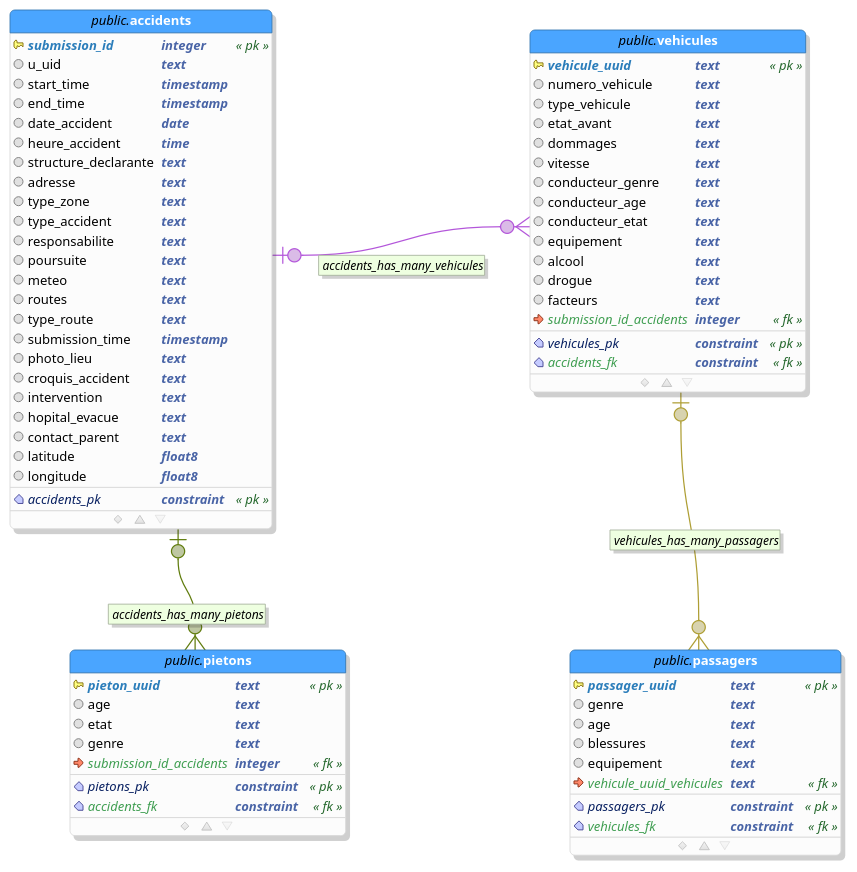
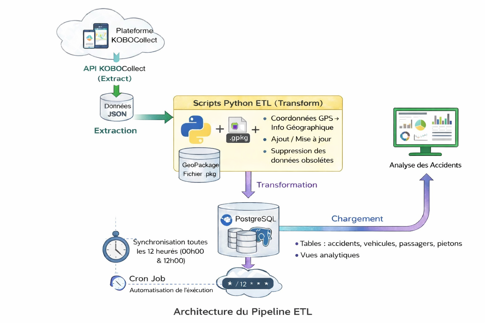

# 📦 Accident ETL

## 📖 Description
Ce projet a pour objectif de mettre en place un pipeline pour les données des accidents collectées à partir de kobo,
nous avons les tables suivantes:
- accidents
- véhicules
- passagers
- pietons  
- 
Les données sont centralisées dans une base **PostgreSQL** pour permettre des analyses, rapports et historiques.

---

## 🛠️ Technologies utilisées
- **Python 3.x**
- **PostgreSQL** (base de données)
- **API KOBO**
- **cron** (automatisation des synchronisations)

---

## 📂 Structure du projet
```bash
── accidents
    ├── logs
    ├── pythonfile
    │   ├── etl.py  
    ├── README.md
    ├── requirements.txt
    └── sql
        ├── accdidents.png
        ├── accident.sql
        └── analytique.sql
---
```




## 🚀 Installation

### 1️⃣ Cloner le projet
```bash
git clone https://github.com/monrepo/accidents.git
cd accidents

2️⃣ Créer et activer un environnement virtuel

python3 -m venv venv
source venv/bin/activate   # Sur Linux/Mac
venv\Scripts\activate      # Sur Windows

3️⃣ Installer les dépendances
pip install -r requirements.txt

4️⃣ Configurer les variables d'environnement
cp .env.example .env

⏳ Automatisation avec cron
1. Synchronisation quotidienne (remplissage du datalake) à 12h et à minuit.

0 0,12 * * * /path/to/venv/bin/python /path/to/project/etl.py >> /var/log/etl.log 2>&1
```




